# Biblioteca IPF — Trabajo Práctico N° 4

App integradora desarrollada con **React Native**, **Expo** y **Expo Router** para la Tecnicatura Superior en Desarrollo de Software Multiplataforma (Instituto Politécnico Formosa).

- **Versión del SDK de Expo:** `Expo SDK 58` (`expo ~58.0.26`, `expo-router ~58.0.32`, `react-native 0.88.1`, `typescript ~6.0.3`)
- **Módulos nativos instalados:** únicamente `expo-camera` y `expo-notifications` (más `@expo/vector-icons`, `@react-native-async-storage/async-storage` para persistencia opcional y `jest-expo` para pruebas unitarias opcionales).

---

## Cómo ejecutar el proyecto

```powershell
# 1. Instalar dependencias
npm install

# 2. Iniciar el servidor de Expo para probar en Expo Go (Android o iOS)
npx expo start

# 3. Verificaciones obligatorias
npx tsc --noEmit
npx expo lint

# 4. Tests unitarios de Pila y Cola (desafío opcional)
npm test
```

### Credenciales del personal de biblioteca (pantalla `/login`)
- **Usuario:** `bibliotecario`
- **Clave:** `ipf2026`

---

## Árbol de carpetas de `src/app` y navegadores

```text
src/app/
├── _layout.tsx                  # Stack raíz (anchor: "(tabs)") + BibliotecaProvider + Stack.Protected (/login, /mostrador)
├── (tabs)/
│   ├── _layout.tsx              # Tabs (import { Tabs } from 'expo-router/js-tabs') con íconos Ionicons
│   ├── (catalogo)/
│   │   ├── _layout.tsx          # Stack propio de la tab "Catálogo" (header con botón "Personal" / "Mostrador")
│   │   ├── index.tsx            # Ruta: / (Catálogo + "Vistos recientemente" + accesos Buscar y Escanear)
│   │   └── libro/
│   │       └── [isbn].tsx       # Ruta: /libro/[isbn] (Detalle validado dentro de la tab Catálogo)
│   └── reservas.tsx             # Ruta: /reservas (Tab "Mis reservas": préstamos, recordatorios, espera y avisos)
├── buscar.tsx                   # Ruta: /buscar?q= (Stack raíz, búsqueda en URL con debounce y limpieza)
├── escanear.tsx                 # Ruta: /escanear (Stack raíz, escáner EAN-13 con 4 estados + ISBN manual)
├── reservar/
│   └── [isbn].tsx               # Ruta: /reservar/[isbn] (Stack raíz, presentation: "modal")
├── permisos/
│   └── [recurso].tsx            # Ruta: /permisos/[recurso] (Stack raíz, presentation: "modal")
├── login.tsx                    # Ruta: /login (Modal, solo existe sin sesión vía Stack.Protected)
├── mostrador.tsx                # Ruta: /mostrador (Stack raíz, solo existe con sesión vía Stack.Protected)
├── reserva.tsx                  # Ruta: /reserva (<Redirect href="/reservas" />)
└── +not-found.tsx               # Cualquier ruta inexistente (404 mostrando usePathname())
```

---

## Bloque `plugins` de `app.json` comentado

```jsonc
"plugins": [
  // Habilita el enrutamiento basado en archivos desde src/app y los deep links con scheme "bibliotecaipf"
  "expo-router",
  [
    // Configura la pantalla de carga inicial (splash) nativa
    "expo-splash-screen",
    {
      "backgroundColor": "#208AEF",
      "image": "./assets/images/splash-icon.png",
      "imageWidth": 76
    }
  ],
  [
    // Configura la cámara aplicando el principio de mínimo privilegio:
    // declara solo el texto de propósito de cámara y desactiva explícitamente micrófono / audio
    "expo-camera",
    {
      "cameraPermission": "Usamos tu cámara para leer el código de barras de los libros y abrir su ficha al instante.",
      "microphonePermission": false,
      "recordAudioAndroid": false
    }
  ],
  [
    // Configura las notificaciones locales y define el canal por defecto "prestamos" en Android
    "expo-notifications",
    {
      "defaultChannel": "prestamos"
    }
  ]
]
```

---

## Tabla de permisos

| Recurso | Módulo | Cuándo se pide | Alternativa si se deniega o bloquea |
| :--- | :--- | :--- | :--- |
| **Cámara** | `expo-camera` (`useCameraPermissions`) | Solo cuando la persona entra a `/escanear` y toca **“Habilitar cámara”** pasando primero por `/permisos/camara`. | Formulario **“Ingresar ISBN a mano”** siempre visible en `/escanear` + botón “Abrir Ajustes” si está bloqueado. |
| **Notificaciones locales** | `expo-notifications` | Únicamente cuando la persona activa el interruptor **“Recordarme”** en un préstamo en `/reservas` (creando antes el canal `"prestamos"` en Android). | Los vencimientos siguen visibles en `/reservas` y las entregas desde el mostrador aparecen como **avisos internos** dentro de la app. |

---

## Justificación de `blockedPermissions` (Android)

En `app.json` se declararon explícitamente en `android.blockedPermissions`:
- `android.permission.RECORD_AUDIO`: la app solo escanea códigos de barras EAN-13, nunca graba video con audio.
- `android.permission.ACCESS_FINE_LOCATION` y `android.permission.ACCESS_COARSE_LOCATION`: la app no utiliza ubicación ni instala `expo-location`.
- `android.permission.READ_MEDIA_IMAGES` y `android.permission.READ_EXTERNAL_STORAGE`: la app no accede a la galería ni instala `expo-image-picker`.

Esto aplica el principio de **mínimo privilegio** y evita que dependencias transitivas agreguen permisos innecesarios al `AndroidManifest.xml` final.

---

## Deep links de prueba

En producción / Development Build se usa el esquema `bibliotecaipf://`.  
En **Expo Go** se reemplaza por `exp://<IP_LOCAL>:8081/--/`:

| Caso | URL con `scheme` propio | Equivalente en Expo Go |
| :--- | :--- | :--- |
| Detalle existente (*Ficciones*) | `bibliotecaipf://libro/9789875666481` | `exp://<IP>:8081/--/libro/9789875666481` |
| Detalle con ISBN inválido | `bibliotecaipf://libro/123` | `exp://<IP>:8081/--/libro/123` |
| Buscador precargado | `bibliotecaipf://buscar?q=borges` | `exp://<IP>:8081/--/buscar?q=borges` |
| Ruta protegida sin sesión | `bibliotecaipf://mostrador` | `exp://<IP>:8081/--/mostrador` |
| Redirección de URL vieja | `bibliotecaipf://reserva` | `exp://<IP>:8081/--/reserva` |
| Escáner | `bibliotecaipf://escanear` | `exp://<IP>:8081/--/escanear` |
| Pantalla 404 | `bibliotecaipf://ruta-inexistente` | `exp://<IP>:8081/--/ruta-inexistente` |

---

## Validaciones de entrega (`tsc`, `lint` y tests)

### `npx tsc --noEmit`
```text
(sin errores — código de salida 0)
```

### `npx expo lint`
```text
(sin errores ni advertencias — código de salida 0)
```

### `npm test` (desafío opcional — 8 tests unitarios de `Pila` y `Cola`)
```text
PASS src/estructuras/__tests__/estructuras.test.ts
  Pila
    √ apila y desapila respetando el orden LIFO
    √ devuelve undefined al hacer pop o tope en una pila vacía
    √ aArray devuelve del más reciente al más antiguo sin exponer el estado interno
    √ clonar crea una instancia independiente
  Cola
    √ encola y desencola respetando el orden FIFO sin usar shift
    √ devuelve undefined al desencolar o consultar frente en una cola vacía
    √ queda vacía después de desencolar todos los elementos
    √ clonar crea una copia independiente de los elementos activos

Test Suites: 1 passed, 1 total
Tests:       8 passed, 8 total
```

---

## Desafíos opcionales implementados (A6)

- **Persistencia:** préstamos, vistos recientemente, avisos e identificadores de notificaciones guardados en `@react-native-async-storage/async-storage`, esperando `hidratado` en `src/app/_layout.tsx` para no mostrar la app vacía al iniciar.
- **Pruebas unitarias:** 8 casos con `jest-expo` en `src/estructuras/__tests__/estructuras.test.ts`.
- **Debounce:** 300 ms con limpieza de temporizador en `src/app/buscar.tsx`.
- **Modo oscuro:** `useColorScheme()` integrado con `COLORES_CLARO` y `COLORES_OSCURO` en `src/constants/tema.ts` mediante `src/hooks/useTema.ts`.

---

## Capturas de pantalla (F2.4)

### 1. Catálogo (cargando, error y datos) y Vistos recientemente
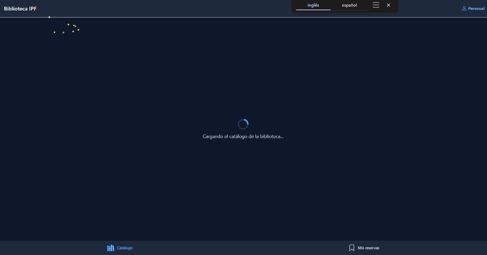
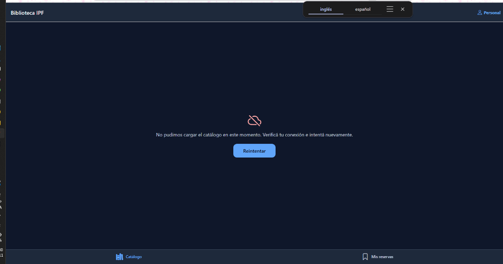
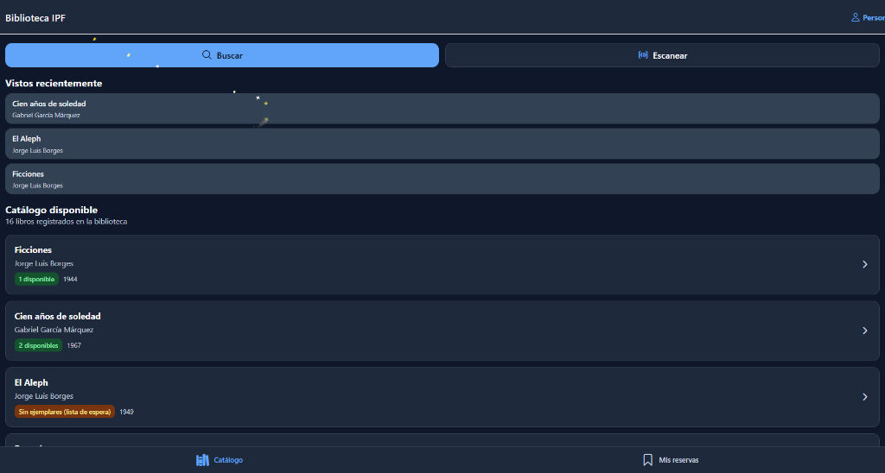
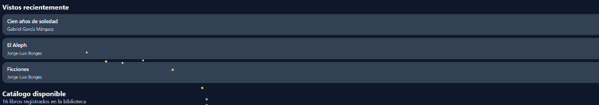

### 2. Buscador y Detalle inexistente
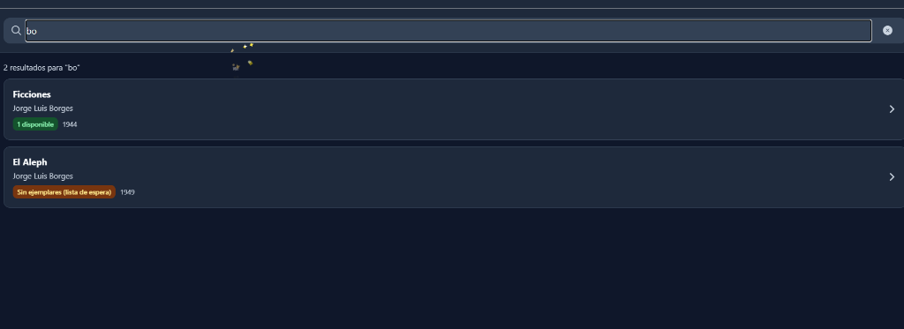
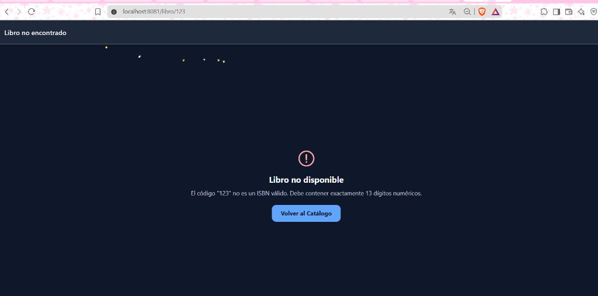

### 3. Reserva con ejemplares y sin ejemplares (lista de espera)
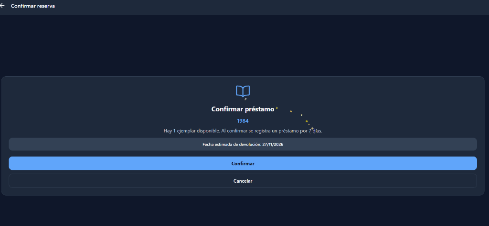
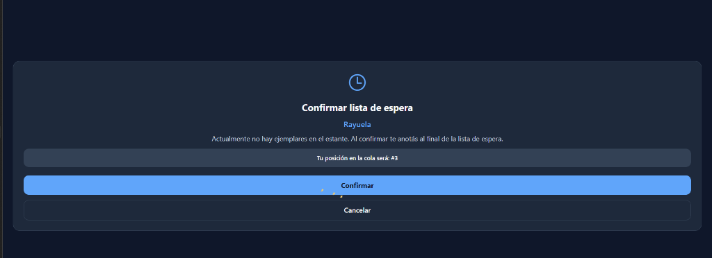

### 4. Escáner y permiso de cámara
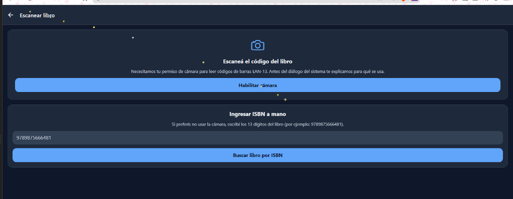
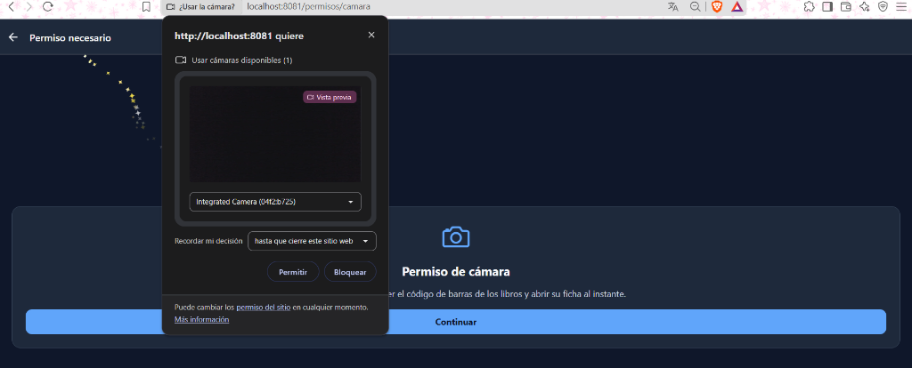

### 5. Notificación local recibida en Expo Go (15 s demo)
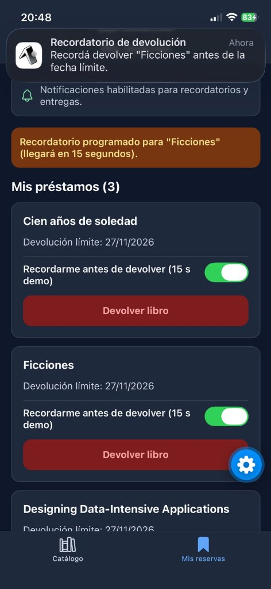

### 6. Ingreso de personal y Mostrador (antes y después de “Entregar al siguiente”)
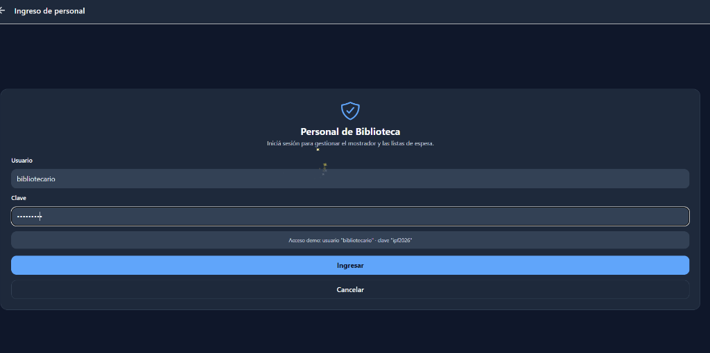
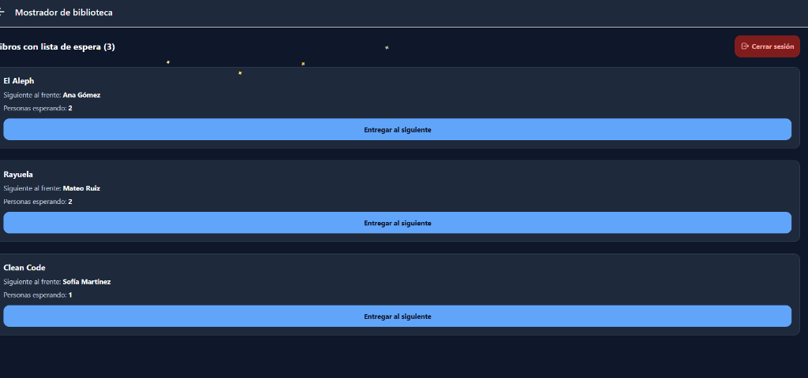
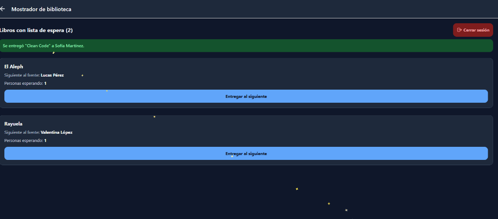

### 7. Pantalla 404
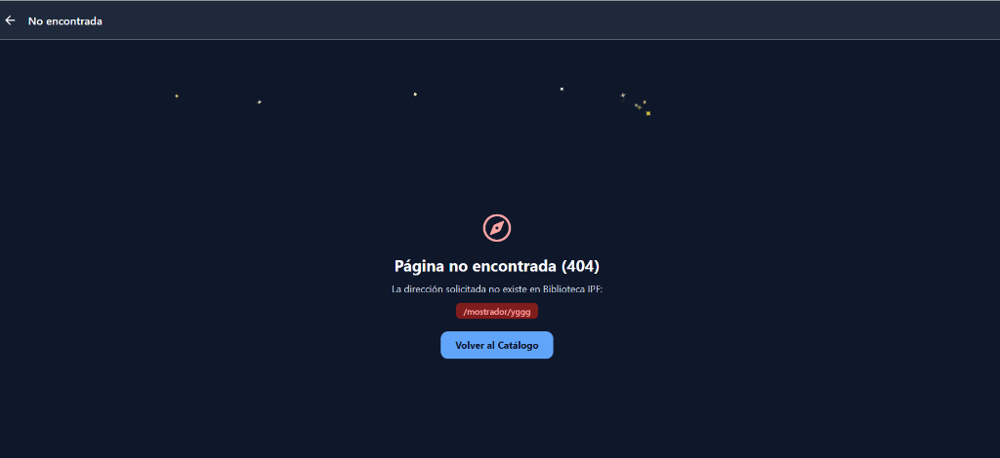
